  

  
  
  
  

  

---

### 👩‍💻 About me

Fourth-year **Information Systems Engineering** student at Universidad Nacional de Costa Rica (UNA), looking for a **professional internship in software development**.

- 🧩 Full stack training: REST APIs, relational databases and mobile/web interfaces, applying **Clean Architecture, MVVM and SOLID**
- 🤝 Team projects under **Scrum and Kanban**, with Pull Request reviews, technical documentation and testing with PHPUnit and CI
- 🤖 Critical use of AI tools in my workflow: Claude Code, GitHub Copilot, Google Antigravity and OpenCode
- 🎓 Associate Degree in Computer Applications Programming (UNA) · Bachelor's expected **July 2027**
- 🌎 Heredia, Costa Rica · Spanish (native) · English (B2)

🌌 **See my projects, experience and more on my portfolio → [portafolio-abigail.vercel.app](https://portafolio-abigail.vercel.app/)**

---

### 🛠️ Tech stack

**Backend**

  

**Frontend & mobile**

  

**Databases**

  
  &nbsp;+ SQL Server · Entity Framework Core

**Tools**

  
  &nbsp;+ Jira

